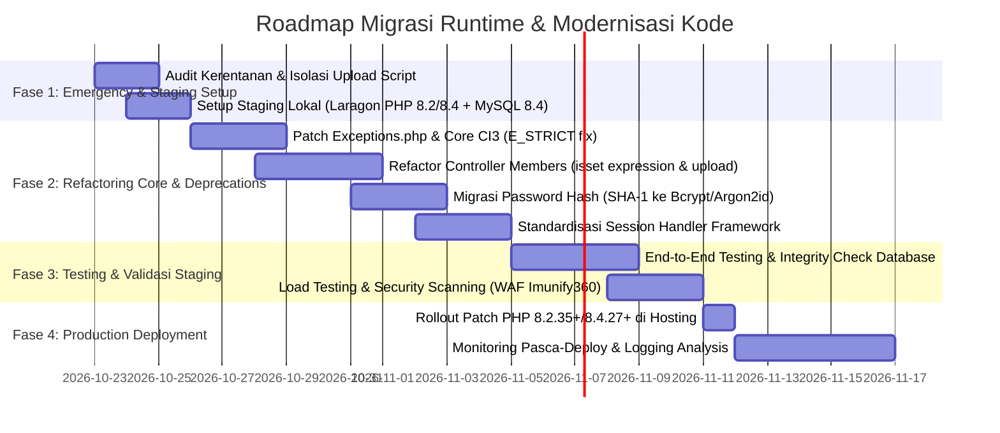

# ROADMAP PENGEMBANGAN & MITIGASI BUG SISTEM
## Project: members.julehajatim (Juru Sembelih Halal Jawa Timur)
**Dokumen:** Development Roadmap, Bug Mitigation, & Migration Strategy  
**Penyusun:** Senior Fullstack Developer & Security Lead  
**Tanggal:** 23 Oktober 2026  
**Status:** Baseline Active Plan  

---

## 1. Executive Summary
Sistem `members.julehajatim` saat ini dibangun di atas arsitektur monolitik **CodeIgniter 3.1.11** yang awalnya berjalan pada lingkungan **PHP 8.0**. Mengingat PHP 8.0 telah mencapai masa *End of Life* (EOL) dan adanya eskalasi kerentanan keamanan kritis berstatus P0 (**CVE-2026-109618** dan **CVE-2026-109619** dengan skor CVSS 9.2 yang memungkinkan *Remote Code Execution* tanpa autentikasi), modernisasi stack menjadi prioritas operasional paling mendesak.

Dokumen ini memetakan timeline migrasi, rencana penyesuaian sintaks (refactoring), strategi mitigasi bug warisan, mekanisme pengujian pada staging lokal (Laragon/MySQL 8.4), serta SOP deployment yang aman ke server production.

---

## 2. Timeline Migrasi Versi PHP (PHP 8.0 → PHP 8.2+ / PHP 8.4)

Peningkatan versi runtime PHP dilakukan dengan pendekatan bertahap guna memastikan kestabilan fungsional 1.050 data anggota aktif tanpa menyebabkan downtime atau regresi fungsional.



### Milestone & Target Deliverables

| Fase | Periode | Fokus Utama | Target Deliverable |
| :--- | :--- | :--- | :--- |
| **Fase 1: Tanggap Darurat & Staging** | Hari ke 1–3 | Mitigasi celah CVE, setup environment staging | Lingkungan staging lokal replika production siap uji di PHP 8.2.35 / 8.4.3 |
| **Fase 2: Refactoring Sintaks PHP** | Hari ke 4–10 | Perbaikan fatal error, deprecations, & security flaws | Kode CI3 berjalan bersih (zero warning/fatal error) di PHP 8.2+ & PHP 8.4 |
| **Fase 3: Staging Verification** | Hari ke 11–14 | Uji regresi seluruh modul (Member, Bimtek, Sertifikat) | Berita Acara Uji Staging & Laporan Penetrasi Internal |
| **Fase 4: Deployment & Cutover** | Hari ke 15–20 | Migrasi cPanel/Jagoan Hosting, WAF Imunify360 | Production berjalan di PHP versi aman dengan proteksi WAF aktif |

---

## 3. Matriks Mitigasi Bug & Penyesuaian Sintaks (Code Refactoring)

Berdasarkan analisis log error aktual (`error_log`) dan perbedaan spesifikasi PHP 8.0 ke PHP 8.2 / 8.4, berikut adalah inventarisasi bug dan solusinya:

### 3.1. Deprecated Constant `E_STRICT` pada PHP 8.4
- **Lokasi Terdeteksi:** `system/core/Exceptions.php` baris 75
- **Akar Masalah:** Di PHP 8.4, error level `E_STRICT` telah dihapus secara resmi dari PHP runtime. Pemanggilan konstanta ini memicu `PHP Deprecated: Constant E_STRICT is deprecated since 8.4`.
- **Rencana Solusi:**
  Lakukan patch pada file `system/core/Exceptions.php` untuk membungkus pemeriksaan `E_STRICT` dengan validasi versi PHP atau menghilangkannya dari bitmask error reporting jika `PHP_VERSION_ID >= 80400`.

### 3.2. Fatal Error: `Cannot use isset() on the result of an expression`
- **Lokasi Terdeteksi:** `application/controllers/Members.php` baris 48
- **Akar Masalah:** Mulai PHP 8.0+, pemanggilan fungsi `isset()` terhadap hasil kembalian suatu ekspresi atau fungsi dilarang keras dan menghasilkan `Fatal Error` (sebelumnya hanya notice/warning).
- **Rencana Solusi:**
  Ubah sintaks dari:
  ```php
  // SINTAKS LAMA (RUSAK DI PHP 8+)
  if (isset($this->input->post('submit'))) ...
  ```
  Menjadi:
  ```php
  // SINTAKS BARU (COMPLIANT)
  $submit = $this->input->post('submit');
  if ($submit !== null) ...
  // Atau menggunakan helper native CodeIgniter:
  if ($this->input->method() === 'post') ...
  ```

### 3.3. Unhandled Exception & Empty Path pada File Upload (`ValueError: Path cannot be empty`)
- **Lokasi Terdeteksi:** `aplod.php` baris 9 & `Members.php`
- **Akar Masalah:** Pemanggilan `getimagesize($_FILES["fileToUpload"]["tmp_name"])` tanpa validasi keberadaan file saat request dikirim kosong memicu `ValueError: Path cannot be empty` di PHP 8.x.
- **Rencana Solusi:**
  Tambahkan pengecekan pra-kondisi:
  ```php
  if (!isset($_FILES['fileToUpload']) || $_FILES['fileToUpload']['error'] !== UPLOAD_ERR_OK) {
      throw new InvalidArgumentException("File tidak valid atau belum dipilih.");
  }
  ```

### 3.4. Dynamic Properties Deprecation (PHP 8.2+)
- **Lokasi Terdeteksi:** Seluruh core controller dan model CodeIgniter 3 yang meng-inject library secara dinamis (`$this->load->model(...)`).
- **Rencana Solusi:**
  Tambahkan atribut `#[\AllowDynamicProperties]` pada base controller `CI_Controller` dan `CI_Model` di `system/core/` atau inisialisasi properti secara eksplisit pada class controller turunan.

### 3.5. MySQL 8.4 Strict Mode Incompatibility
- **Lokasi Terdeteksi:** Skrip database `julehaja_members.sql` baris 347 (`eventdate date NOT NULL DEFAULT current_timestamp()`)
- **Akar Masalah:** Di MySQL 8.4+, default value `current_timestamp()` untuk tipe data `DATE` membutuhkan tanda kurung penutup sebagai ekspresi fungsional `(CURRENT_DATE)` atau didefinisikan sebagai `NULL`.
- **Rencana Solusi:**
  - Standarisasi DDL schema ke standar SQL ANSI / MySQL 8.4.
  - Set `stricton => FALSE` pada tahap transisi di `database.php` jika query legacy masih memuat klausa `GROUP BY` non-deterministik, kemudian bertahap diaktifkan kembali.

---

## 4. Alur Kerja Pengujian di Server Staging Lokal

Pengujian dilakukan menggunakan **Laragon Staging Server** dengan konfigurasi ketat menyerupai server produksi sebelum perubahan di-deploy.

```
+--------------------------------------------------------------------------------+
|                             STAGING WORKFLOW PIPELINE                          |
+--------------------------------------------------------------------------------+
   [Local Git Workspace]
             |
             v
   [1. Static Analysis & Linting] (PHP 8.2/8.4 Compatibility Check)
             |
             v
   [2. Staging DB Deployment] (MySQL 8.4.3: julehaaja_members)
             |
             v
   [3. Virtual Host Setup] (staging-members.test via Laragon / Apache 2.4)
             |
             v
   [4. Automated & Manual Regression Testing]
        - Otentikasi & Session Member (Superadmin, Admin Wilayah, Member)
        - CRUD Profil & Kartu Anggota Juleha (ID: SBY..., SDA...)
        - Upload Foto & Dokumen (MIME verification, EXIF sanitization)
        - Modul Bimtek & Partisipasi Kajian
        - Validasi Penerbitan E-Piagam / Sertifikat Digital
             |
             v
   [5. Sign-off & Production Deployment Readiness]
```

### Protokol Verifikasi Staging
1. **Pengaturan Virtual Host:** Konfigurasi Apache di Laragon mengarah ke folder staging dengan direktif `php_admin_flag display_errors On` dan error reporting `E_ALL`.
2. **Data Sanitization:** Database staging menggunakan kloning data anonim untuk data PII tertentu jika diuji oleh pihak ketiga, atau replika terlindungi khusus developer inti.
3. **Smoke Test Matrix:** Menjalankan checklist 25 titik uji fungsional mencakup login, edit data diri, upload berkas, cetak kartu anggota, pencarian member berdasarkan wilayah DPD.

---

## 5. Prosedur Deployment ke Lingkungan Produksi (Deployment Protocol)

Untuk menjamin kelancaran tanpa gangguan layanan bagi anggota Juleha Jatim:

1. **Jendela Pemeliharaan (Maintenance Window):** Dilakukan pada jam non-sibuk (pukul 23:00 - 02:00 WIB).
2. **Snapshot & Backup Penuh:**
   - Database: `mysqldump -u root -p julehaja_members > backup_pre_migration_$(date +%F).sql`
   - File Assets: Kompresi seluruh folder `images/` dan `application/`.
3. **Peningkatan Versi PHP Hosting:**
   - Melalui cPanel MultiPHP Manager, ubah runtime PHP domain `members.julehajatim.com` dari PHP 8.0 ke versi ter-patch aman (**PHP 8.2.35+** atau **PHP 8.4.27+**).
4. **Deploy Source Code Ter-Refactor:**
   - Upload file ter-patch melalui Git deployment atau aman via SSH/SFTP (tanpa menyertakan `.git`, file `.sql`, atau file sensitif).
5. **Aktivasi Rule Imunify360 & WAF:**
   - Verifikasi melalui dashboard hosting bahwa modul Imunify360 WAF aktif dan memonitor trafik terhadap signature CVE-2026-109618/19.
6. **Verifikasi Pasca-Deploy & Rollback Plan:**
   - Cek `error_log` server untuk memastikan tidak ada fatal error baru.
   - Apabila terjadi anomali fatal, lakukan rollback instan runtime PHP ke versi stabil sebelumnya dan restore codebase dari snapshot dalam waktu maksimal 10 menit.
