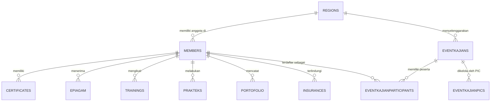

# PRODUCT REQUIREMENTS DOCUMENT (PRD)
## Sistem Informasi Manajemen Anggota Juru Sembelih Halal (Juleha) DPW Jawa Timur
**Domain URL:** `members.julehajatim.com`  
**Versi Dokumen:** 1.0.0  
**Target Rilis:** Produksi Q4 2026  
**Klasifikasi:** Internal System Specification  

---

## 1. Pendahuluan & Latar Belakang

### 1.1. Visi Produk
Mewujudkan satu platform digital terintegrasi yang andal, aman, dan mudah digunakan untuk mengelola data keanggotaan, kompetensi, kegiatan edukasi/bimbingan teknis (BIMTEK), sertifikasi, serta portofolio juru sembelih halal di bawah naungan Dewan Pengurus Wilayah (DPW) Juleha Jawa Timur beserta 31 Dewan Pengurus Daerah (DPD) kabupaten/kota.

### 1.2. Masalah yang Diselesaikan
- Pencatatan data anggota juru sembelih yang tersebar di Jawa Timur belum sepenuhnya tersentralisasi dan rentan terhadap ketidaksinkronan data kompetensi.
- Kebutuhan verifikasi publik dan panitia kurban terhadap legalitas nomor anggota juru sembelih halal (`juleha_id`) yang bersertifikat resmi.
- Pengelolaan sertifikat, bimbingan teknis (BIMTEK), e-piagam, dan perlindungan asuransi keselamatan kerja yang memerlukan pencatatan riwayat digital yang akuntabel.

---

## 2. Struktur Pengguna & Peran (User Roles & Access Control)

Sistem membagi hierarki akses ke dalam 3 tingkat wewenang utama berdasarkan atribut `memberlevel`:

| Level | Peran (Role) | Hak Akses Utama |
| :--- | :--- | :--- |
| **0** | **Superadmin (Pengurus DPW Jatim)** | Akses menyeluruh ke seluruh data anggota Jawa Timur, konfigurasi sistem, manajemen regional (`regions`), audit database, dan penerbitan sertifikat/e-piagam lintas wilayah. |
| **1** | **Admin Daerah (Pengurus DPD)** | Mengelola data anggota pada wilayah kewenangannya (misal: Sidoarjo `SDA`, Surabaya `SBY`), memverifikasi pendaftaran anggota baru, mengelola event kajian daerah, dan menginput PIC bimbingan teknis. |
| **2** | **Anggota Biasa (Juru Sembelih Halal)** | Melihat dan memperbarui profil pribadi, mengunggah foto profil, mengunduh kartu tanda anggota (KTA), melihat riwayat keikutsertaan pelatihan, portofolio sembelihan, dan sertifikat yang dimiliki. |

---

## 3. Arsitektur Domain & Spesifikasi Data (Berdasarkan Ekstraksi Database)

Sistem dibangun di atas model data terstruktur yang telah diekstrak dari database `julehaaja_members`:

### 3.1. Modul Manajemen Anggota (`members`, `regions`)
- **Populasi Data Terdaftar:** 1.050 data anggota aktif.
- **Identifikasi Unik Anggota (`juleha_id`):** Format kode alfanumerik spesifik daerah dan tahun registrasi (contoh: `SDA220003` = Sidoarjo, tahun 2022, urutan ke-3; `SBY220001` = Surabaya).
- **Atribut Member:**
  - Identitas Personal: NIK, nama depan, nama tengah, nama belakang, nama panggilan, gelar akademik/keagamaan (`title`), tempat & tanggal lahir, jenis kelamin.
  - Kontak & Alamat: Alamat domisili lengkap, nomor telepon/WhatsApp aktif.
  - Profesi & Keorganisasian: Pekerjaan pokok, posisi organisasi (`position`), peran (`role`), wilayah administratif (`region`).
  - Akun & Keamanan: Sandi akun, status aktif (`mstatus`: 1 aktif, 0 non-aktif), cap waktu pembuatan (`createdate`).

### 3.2. Modul Event & Kajian (`events`, `eventkajians`, `eventkajianparticipants`, `eventkajianpics`)
- **Klasifikasi Kegiatan:**
  1. *Kajian Fiqih Qurban:* Pendalaman kaidah syariah penyembelihan hewan.
  2. *Training / BIMTEK Juleha:* Pelatihan teknik penyembelihan, handling hewan besar (sapi) dan kecil (kambing/domba), sanitasi, serta standar kehalalan dan kebersihan.
  3. *Praktek Lapangan:* Simulasi langsung pemotongan hewan dengan pengawasan instruktur berlisensi.
- **Fitur Modul:**
  - Penjadwalan kajian (tanggal, waktu, lokasi, deskripsi materi).
  - Penugasan PIC acara dari kalangan pengurus daerah.
  - Pencatatan presensi peserta berbasis relasi data anggota.

### 3.3. Modul Sertifikasi & Piagam Digital (`certificates`, `epiagam`)
- **Penerbitan Sertifikat:** Pengaitan sertifikat keahlian juru sembelih halal berdasarkan nomor ID anggota.
- **Penyimpanan Metadata:** Judul sertifikat/pelatihan, tanggal kelulusan, dan tautan dokumen piagam elektronik (e-piagam).
- **Verifikasi Publik:** Fitur pengecekan keabsahan piagam melalui scan QR code pada kartu anggota atau sertifikat.

### 3.4. Modul Rekam Jejak Kompetensi (`trainings`, `prakteks`, `portofolio`)
- **Pelatihan Resmi (`trainings`):** Riwayat partisipasi bimbingan teknis tingkat dasar, lanjutan, maupun sertifikasi kompetensi BNSP.
- **Uji Praktek (`prakteks`):** Evaluasi kecakapan fisik penyembelihan: ketajaman bilah, kecepatan rebahan (*handling*), pemutusan 3 saluran (tenggorokan/esofagus, trakea, dan dua pembuluh darah leher).
- **Portofolio Lapangan (`portofolio`):** Catatan riwayat tugas penyembelihan mandiri atau tim (misal pada masa Idul Adha di masjid-masjid dan instansi).

### 3.5. Modul Asuransi & Perlindungan K3 (`insurances`)
- Pengelolaan kepesertaan asuransi kecelakaan kerja bagi anggota aktif juru sembelih yang bertugas di lapangan.
- Pencatatan tingkatan proteksi (`grade`) dan masa berlaku perlindungan.

### 3.6. Modul Kemitraan Rumah Potong Hewan (`rphs`)
- Pemetaan jaringan dan kemitraan dengan Rumah Potong Hewan (RPH) di 31 kabupaten/kota Jawa Timur untuk penempatan tenaga juru sembelih halal bersertifikat.

---

## 4. Persyaratan Fungsional Sistem (Functional Requirements)

### 4.1. Modul Otentikasi & Akun
- **FR-AUTH-01:** Pengguna dapat melakukan login menggunakan kombinasi `juleha_id` dan kata sandi.
- **FR-AUTH-02:** Sistem wajib menerapkan hashing kata sandi yang aman (`password_hash` standar Bcrypt/Argon2id) dan menonaktifkan enkripsi SHA-1 usang.
- **FR-AUTH-03:** Sistem harus menghentikan pengiriman kata sandi melalui parameter GET URL (`authhandlerget`) dan mewajibkan request via payload POST terenkripsi HTTPS.
- **FR-AUTH-04:** Sistem menerapkan Session Timeout otomatis setelah 30 menit tanpa aktivitas pengguna.

### 4.2. Modul Direktori & Profil Anggota
- **FR-MEM-01:** Admin dapat melakukan pencarian data anggota dengan filter berdasarkan wilayah daerah (`region`), nomor ID (`juleha_id`), nama, dan status keaktifan.
- **FR-MEM-02:** Pengguna dapat memperbarui informasi kontak pribadi dan mengunggah foto profil resmi.
- **FR-MEM-03:** Sistem secara otomatis memvalidasi jenis file gambar (ekstensi, MIME type, ukuran maksimum 500 KB) dan melakukan konversi serta kompresi terstandarisasi.
- **FR-MEM-04:** Sistem menyediakan fitur cetak Kartu Tanda Anggota (KTA) digital dengan identitas visual terstandarisasi DPW Juleha Jatim.

### 4.3. Modul Event & Peserta
- **FR-EVT-01:** Pengurus dapat membuat agenda kegiatan baru dengan menentukan kuota peserta, lokasi, tanggal, dan PIC acara.
- **FR-EVT-02:** Anggota dapat mendaftarkan diri secara mandiri ke event kajian/bimtek yang dibuka untuk umum atau wilayahnya.
- **FR-EVT-03:** Admin dapat mengekspor rekapitulasi daftar hadir kegiatan ke dalam format spreadsheet/PDF.

### 4.4. Modul Sertifikat Digital
- **FR-CERT-01:** Superadmin dapat mengunggah template dan menerbitkan e-piagam kelulusan bagi anggota yang telah menyelesaikan pelatihan.
- **FR-CERT-02:** Setiap e-piagam dilengkapi dengan nomor registrasi unik yang dapat divalidasi keasliannya secara publik tanpa harus login.

---

## 5. Persyaratan Non-Fungsional (Non-Functional Requirements)

### 5.1. Keamanan & Kepatuhan Perlindungan Data (Data Privacy)
- **Kepatuhan UU Perlindungan Data Pribadi (UU PDP):** Mengingat database memuat data identitas sensitif (NIK, tanggal lahir, nomor handphone 1.050 anggota), seluruh akses eksternal harus terotentikasi dan data sensitif di-masking pada tampilan publik.
- **Validasi Input & Proteksi Query:** Seluruh input wajib divalidasi terhadap SQL Injection (menggunakan Query Builder / Prepared Statement) dan Cross-Site Scripting (XSS).
- **Proteksi Berkas:** Direktori upload berkas harus diproteksi dari eksekusi skrip PHP melalui konfigurasi `.htaccess` (`php_flag engine off`).

### 5.2. Kinerja & Ketersediaan (Performance & Availability)
- **Waktu Respon Halaman:** Halaman profil dan daftar anggota harus dimuat dalam waktu kurang dari 1,5 detik pada koneksi standar 4G.
- **Ketersediaan Layanan (Uptime):** Menjamin tingkat ketersediaan minimal 99,5% per bulan, terutama saat periode puncak menjelang Hari Raya Idul Adha.
- **Optimasi Database:** Seluruh relasi kunci asing (`member_id`, `region`, `eventdate`) harus memiliki indeks database yang tepat untuk menjaga performa query.

### 5.3. Kompatibilitas Perangkat (Responsive UI)
- Tampilan antarmuka harus sepenuhnya responsif pada perangkat mobile (smartphone juru sembelih di lapangan), tablet, dan desktop.

---

## 6. Kriteria Keberhasilan Produk (Success Metrics)
1. **100% Migrasi Data Bersih:** Seluruh 1.050 data anggota, 31 wilayah, serta riwayat pelatihan tersinkronisasi tanpa ada data yang hilang (*zero data loss*).
2. **Eliminasi Kerentanan P0:** Sistem berjalan pada runtime PHP yang telah ditambal terhadap CVE-2026-109618 dan CVE-2026-109619.
3. **Peningkatan Kualitas Keamanan:** Tidak ada lagi skrip upload terbuka tanpa otentikasi di lingkungan web root.
4. **Kepuasan Pengguna:** Kemudahan akses anggota dalam melihat data keanggotaan dan e-piagam mereka secara real-time.
