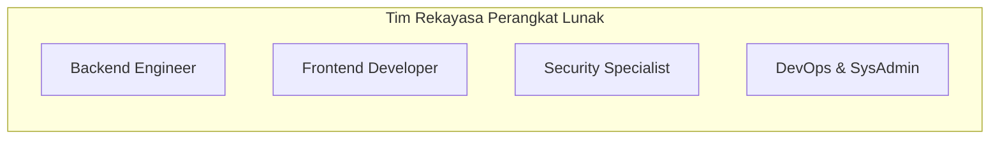

# STANDAR KOMPETENSI & KUALIFIKASI ENGINEERING (TECH STACK & SKILL MATRIX)
## Project: members.julehajatim (Juru Sembelih Halal DPW Jawa Timur)
**Dokumen:** Engineering Standards, Architecture Guidelines & Team Skill Matrix  
**Penyusun:** Senior Fullstack Architect & Security Specialist  
**Versi:** 1.0.0  
**Tanggal:** 23 Oktober 2026  

---

## 1. Definisi Arsitektur & Tech Stack Terstandarisasi

Untuk memelihara, mengamankan, dan mengembangkan platform `members.julehajatim` secara profesional dan berkelanjutan, tim pengembang wajib berpedoman pada spesifikasi teknologi berikut:

```
+---------------------------------------------------------------------------------+
|                                 CORE TECH STACK                                 |
+---------------------------------------------------------------------------------+
| Backend Runtime:     PHP 8.2.35+ / PHP 8.4.27+ (Strict Mode, Typed Properties)  |
| Backend Framework:   CodeIgniter 3.1.x (Modernized) / Roadmap to Laravel 11+    |
| Database Engine:     MySQL 8.4 LTS / MariaDB 10.6+ (InnoDB, utf8mb4_unicode_ci) |
| Frontend Stack:      HTML5 Semantic, Vanilla CSS3 / Bootstrap 5, Modern JS ES6+|
| UI Components:       DataTables.js, SweetAlert2, Chart.js (Dashboard Analitik)  |
| Security & WAF:      Imunify360, ModSecurity, OWASP CRS, Argon2id Cryptography  |
| Infrastructure:      CloudLinux / Ubuntu LTS, Apache 2.4 / Nginx Reverse Proxy  |
| Version Control:     Git (GitFlow Branching Model), GitHub Protected Branches    |
| Staging Environment: Laragon Local Server, PHP CLI 8.4, HeidiSQL / MySQL CLI    |
+---------------------------------------------------------------------------------+
```

---

## 2. Standar Coding & Prinsip Rekayasa Perangkat Lunak (Coding Standards)

Setiap kontributor kode pada proyek ini wajib mematuhi panduan teknis berikut guna mencegah akumulasi *technical debt* dan celah keamanan:

### 2.1. Standar Format & Gaya Penulisan Kode (PSR Compliance)
- **PSR-1 (Basic Coding Standard):** Penamaan class menggunakan `PascalCase`, method menggunakan `camelCase`, dan konstanta menggunakan `UPPER_SNAKE_CASE`. Berkas PHP wajib menggunakan tag pembuka `<?php` murni tanpa tag penutup `?>` pada akhir file logika.
- **PSR-12 (Extended Coding Style Guide):** Indentasi 4 spasi (bukan tab), batasan panjang baris maksimal 120 karakter, penempatan kurung kurawal pembuka method pada baris baru.
- **Strict Typing:** Seluruh method baru wajib menyertakan *type hinting* pada parameter dan *return type*:
  ```php
  public function getMemberById(int $id): ?array
  {
      return $this->db->get_where('members', ['id' => $id])->row_array() ?: null;
  }
  ```

### 2.2. Pola Arsitektur MVC & Pemisahan Tanggung Jawab (Separation of Concerns)
- **Fat Model, Skinny Controller:** Controller hanya bertugas sebagai orkestrator (menerima request, memvalidasi input, memanggil model/service, dan mengembalikan view atau JSON). Dilarang keras menaruh query SQL atau logika kalkulasi bisnis di dalam controller.
- **Zero Business Logic in Views:** Berkas view hanya boleh memuat logika presentasi visual sederhana (`foreach`, `if-else` untuk formatting UI). Dilarang memanggil database atau session native langsung di dalam view.
- **Pembersihan Skrip Liar:** Seluruh aksi wajib melalui routing framework MVC. Dilarang menempatkan skrip PHP mandiri di dalam folder publik (seperti kasus `aplod.php`).

### 2.3. Prinsip Keamanan Penulisan Kode (Secure Coding Guidelines)
- **Defensive Input Handling:** Seluruh input dari pengguna (`$_GET`, `$_POST`, `$_FILES`) wajib divalidasi dan disanitasi sebelum diproses.
- **SQL Injection Prevention:** Seluruh interaksi database wajib menggunakan *Query Builder* CodeIgniter atau *Prepared Statements* dengan *parameter binding*. Dilarang melakukan konkatenasi string SQL mentah.
- **Cross-Site Scripting (XSS) Prevention:** Output data yang ditampilkan ke browser wajib di-escape menggunakan fungsi pembungkus seperti `html_escape()` atau `htmlspecialchars(..., ENT_QUOTES, 'UTF-8')`.
- **Kriptografi Teruji:** Dilarang menggunakan fungsi hash satu arah usang (`md5()`, `sha1()`). Otentikasi wajib menggunakan fungsi native PHP: `password_hash($rawPassword, PASSWORD_ARGON2ID)` atau `PASSWORD_BCRYPT`.

---

## 3. Matriks Kualifikasi Skill Tim Pengembang (Skill Matrix)

Untuk memastikan sistem dikelola oleh personel yang kompeten dan bertanggung jawab, berikut adalah rincian kualifikasi teknis yang disyaratkan pada 4 pilar engineering:



### 3.1. Backend Engineer
- **Keahlian Inti:**
  - Penguasaan mendalam **PHP 8.2+ dan PHP 8.4** (memahami perbedaan fitur, deprecations, typed properties, union types, nullsafe operator, dan match expression).
  - Pengalaman arsitektur MVC pada framework CodeIgniter 3/4 serta ekosistem modern (Laravel).
  - Kemampuan refactoring legacy codebase (menghilangkan *technical debt* dan peringatan runtime).
- **Keahlian Database:**
  - Optimasi query relational (MySQL 8.x / MariaDB 10.x).
  - Pemahaman teknik pengindeksan (B-Tree index, composite index) untuk mempercepat pencarian data 1.050+ anggota.
  - Perancangan skema data normalisasi hingga bentuk 3NF (Third Normal Form) dan transactional integrity (`ACID`).

### 3.2. Frontend Developer
- **Keahlian Inti:**
  - Penguasaan **HTML5 Semantik** dan **CSS3 modern** (Flexbox, CSS Grid, Media Queries) untuk menghasilkan antarmuka responsif ramah perangkat mobile.
  - Penguasaan JavaScript modern (ES6+) untuk manipulasi DOM asinkron (AJAX / Fetch API) tanpa reload halaman.
  - Implementasi komponen UI enterprise: DataTables dengan *server-side processing*, validasi form client-side interaktif, dan modal dialog terstandarisasi.
- **Aksesibilitas & UX:**
  - Memastikan antarmuka intuitif bagi anggota juru sembelih dari berbagai latar belakang usia dan tingkat literasi teknologi.
  - Optimasi aset visual (kompresi WebP/JPEG terstandarisasi untuk kartu tanda anggota).

### 3.3. Security Specialist & Application Auditor
- **Keahlian Inti:**
  - Pemahaman mendalam kerangka kerja **OWASP Top 10** (khususnya *Broken Access Control*, *Cryptographic Failures*, *Injection*, dan *Security Misconfiguration*).
  - Analisis kerentanan CVE (seperti **CVE-2026-109618/19**) dan formulasi mitigasi mitigasi virtual patching / WAF rule tuning.
  - Kemampuan melakukan *Code Review* berbasis keamanan (SAST - Static Application Security Testing) dan *Penetration Testing* manual.
- **Konfigurasi Proteksi Server:**
  - Pengelolaan **Imunify360**, ModSecurity, dan konfigurasi hardening web server (`.htaccess`, header keamanan HTTP seperti `Content-Security-Policy`, `X-Frame-Options`, `Strict-Transport-Security`).
  - Penegakan regulasi kepatuhan data pribadi (UU Perlindungan Data Pribadi / UU PDP) terkait perlindungan data kependudukan (NIK dan kontak anggota).

### 3.4. DevOps & Systems Administrator
- **Keahlian Inti:**
  - Pengelolaan server berbasis Linux (CloudLinux, AlmaLinux, Ubuntu Server).
  - Manajemen runtime hosting melalui cPanel, MultiPHP Manager, konfigurasi modul PHP (opcache, imagick, pdo_mysql).
  - Penguasaan Git tingkat lanjut: branching strategy, resolusi merge conflict, Git tag, dan sanitasi repositori (`.gitignore` enforcement).
- **Operasional & Keandalan (Reliability):**
  - Perancangan dan otomatisasi skrip pencadangan berkala (*automated off-site database & assets backup*).
  - Pengaturan staging environment lokal (Laragon/Docker) yang identik dengan server produksi.
  - Penyusunan prosedur *Disaster Recovery* dan *Zero-Downtime Deployment* saat rilis pembaruan.

---

## 4. Evaluasi Kesiapan Tim & Rencana Pelatihan (Upskilling Plan)

Apabila tim pengembang saat ini belum sepenuhnya menguasai standar di atas, program pelatihan berikut wajib dijalankan:
1. **Lokakarya PHP 8.4 Modernization (1 Minggu):** Fokus pada penulisan sintaks aman dan perbaikan kode lama.
2. **Pelatihan Secure Web Development & OWASP (3 Hari):** Fokus pada validasi upload berkas aman, otentikasi berbasis Bcrypt, dan pencegahan RCE.
3. **Simulasi Staging & Deployment SOP (2 Hari):** Praktik pengujian di Laragon lokal hingga cutover tanpa downtime di server produksi.
